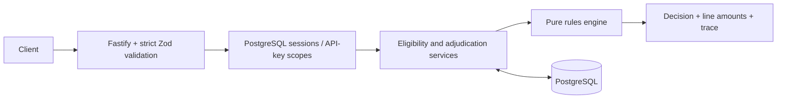

# Alberta Insurance Rules Engine

A TypeScript rules engine, Fastify API, and responsive operations portal for Alberta claim workflows. PostgreSQL stores users, revocable login sessions, patients, coverage, plan versions, adjudications, accumulators, and audit history.

The source specification is preserved in [docs/technical-specification.md](docs/technical-specification.md). Implementation decisions and external release requirements are in [docs/implementation-notes.md](docs/implementation-notes.md).

## Run with Docker

Copy `.env.example` to `.env` and replace the PostgreSQL and initial administrator credentials with organization-owned values:

```sh
docker compose up --build -d
```

Open **http://localhost:8000/** for the operations portal or **http://localhost:8000/docs/** for the API reference.

Docker Compose:

- Starts PostgreSQL 16 with a persistent volume.
- Applies every Drizzle migration.
- Creates the first PostgreSQL-backed administrator when needed.
- Starts the API and compiled React frontend in production mode.
- Does not insert patients, claims, eligibility responses, or plans.

The administrator bootstrap is idempotent and never changes an existing user's password.

## Run with Node

Node 22 is used by Docker and CI. PostgreSQL is required.

```sh
npm ci
npm run build
npm run db:migrate
npm run bootstrap:admin
npm start
```

Set `DATABASE_URL`, `BOOTSTRAP_ADMIN_EMAIL`, and `BOOTSTRAP_ADMIN_PASSWORD` first. The API serves the production frontend from `apps/web/dist`. For frontend development, run `npm run dev:web` in another terminal; Vite uses **http://127.0.0.1:5173/** and proxies the API on port 8000.

For this workspace, local PostgreSQL runs on `127.0.0.1:55438`. Local credentials are stored in the ignored `.env` file; there is no committed password.

## Production data flow

1. Bootstrap the first administrator. Administrators provision other admin, biller, and analyst users through `POST /api/v1/auth/register`.
2. Import an organization-reviewed plan from **Plans & rules**, create one through `POST /api/v1/plans`, or set `PLAN_DIRECTORY` and run `npm run plans:import`.
3. Add a patient and coverage using the configured payer ID.
4. Record the payer's eligibility result through `POST /api/v1/insurance/verify`. A confirmation or transaction reference is required; the server does not generate payer answers.
5. Use `POST /api/v1/evaluate?trace=true` for a non-persisted preview or `POST /api/v1/claims` for an adjudicated claim.

Login returns a random opaque bearer token. Only its SHA-256 hash is stored in `auth_sessions`; logout revokes the session in PostgreSQL. API keys remain available for service integrations and are also stored as hashes.

Claim amounts at the HTTP boundary use dollars per unit. Plan JSON and internal calculations use integer cents. Extra fields, invalid dates, negative amounts, and money with more than two decimal places fail validation.

## Plan configuration

Plan definitions are operational inputs and immutable after publication. Administrators must confirm effective dates, fee amounts, coverage rules, prior authorization, frequency limits, maximums, cost sharing, and coordination rules before import.

Nothing under `examples/plans/` is imported automatically. Those files and the compact code fixtures used by automated tests are examples for development only. Production values, fee schedules, code sets, and eligibility responses must come from the organization's reviewed and licensed sources.

## Capabilities

| Component         | Implementation                                                                                                                                    |
| ----------------- | ------------------------------------------------------------------------------------------------------------------------------------------------- |
| Operations portal | Responsive React dashboard, patient enrollment, payer-response capture, claim workbench, queues, decision detail, plan import, and rule catalogue |
| Authentication    | PostgreSQL users and revocable opaque sessions, role checks, scoped API keys, password hashing, and login rate limits                             |
| Guards            | G001-G003; verified eligibility, exact 24-hour freshness boundary, and immutable coverage snapshots                                               |
| Validation        | R001-R005, R009, R010 in fixed order; identifiers, codes, filing, and residency                                                                   |
| Adjudication      | R006-R017; coverage, authorization, cost sharing, limits, duplicates, necessity, COB, and accident-date routing                                   |
| Lifecycle         | Legal state transitions, history, reasoned overrides, corrected resubmission, and append-only reprocessing                                        |
| Persistence       | PostgreSQL, Drizzle migrations, row locks, idempotency transactions, and immutable audit records                                                  |
| Operations        | Health/readiness probes, Prometheus metrics, Swagger, Docker, Render, and Railway configuration                                                   |



## Verify

```sh
npm run build
npm run typecheck
npm audit --audit-level=high
```

The integration suite uses a disposable PostgreSQL 16 Testcontainer or an explicitly selected `TEST_DATABASE_URL`. See [docs/operations.md](docs/operations.md) for deployment, backup, restore, and operating procedures.

Direct payer connectivity, authoritative fee-guide licensing, payment movement, WCB, and fraud-scoring integrations require external contracts, credentials, and source data. The application does not invent those values or represent the example files as authoritative.
